# Figure pack

> Ready-made pictures of the labs for use in the article. Each one is a capture of an interactive lab in a chosen state, saved at double resolution in `article/figures/`. To change one, edit its entry in `tools/figures/` and run `node tools/figures.js`.

Every picture shows the lab exactly as the page draws it, so the colours keep their meaning: red and blue for the first and second vector or row, amber for targets and results, green for a third series.

## Lecture 1 · The Geometry of Linear Equations

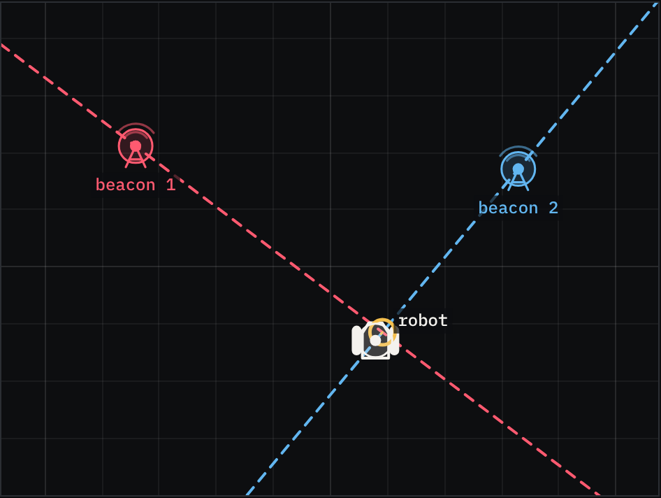

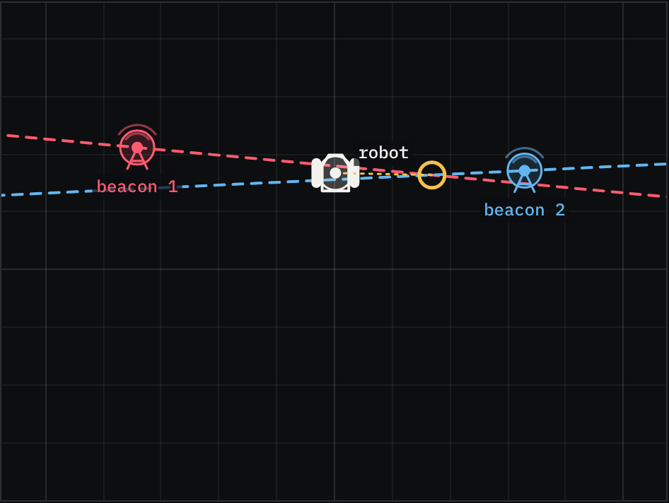

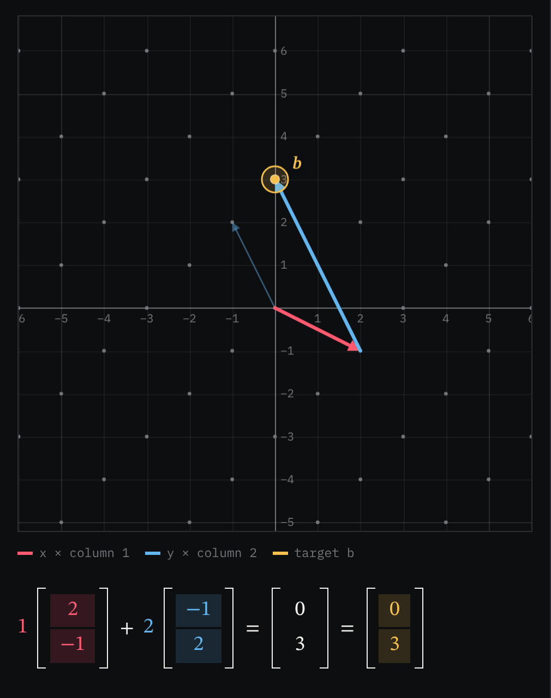

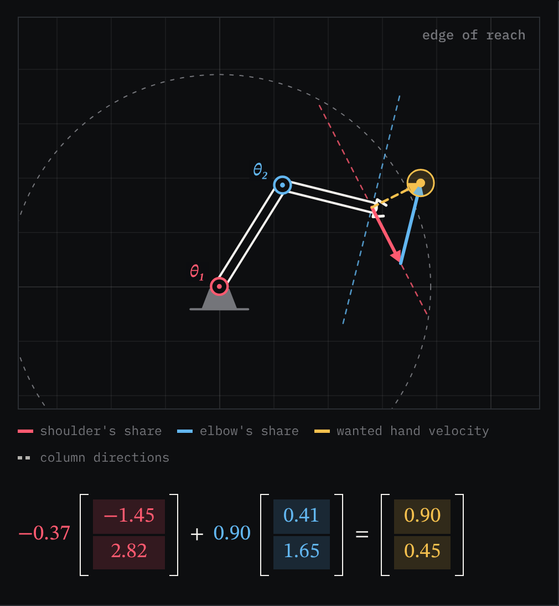

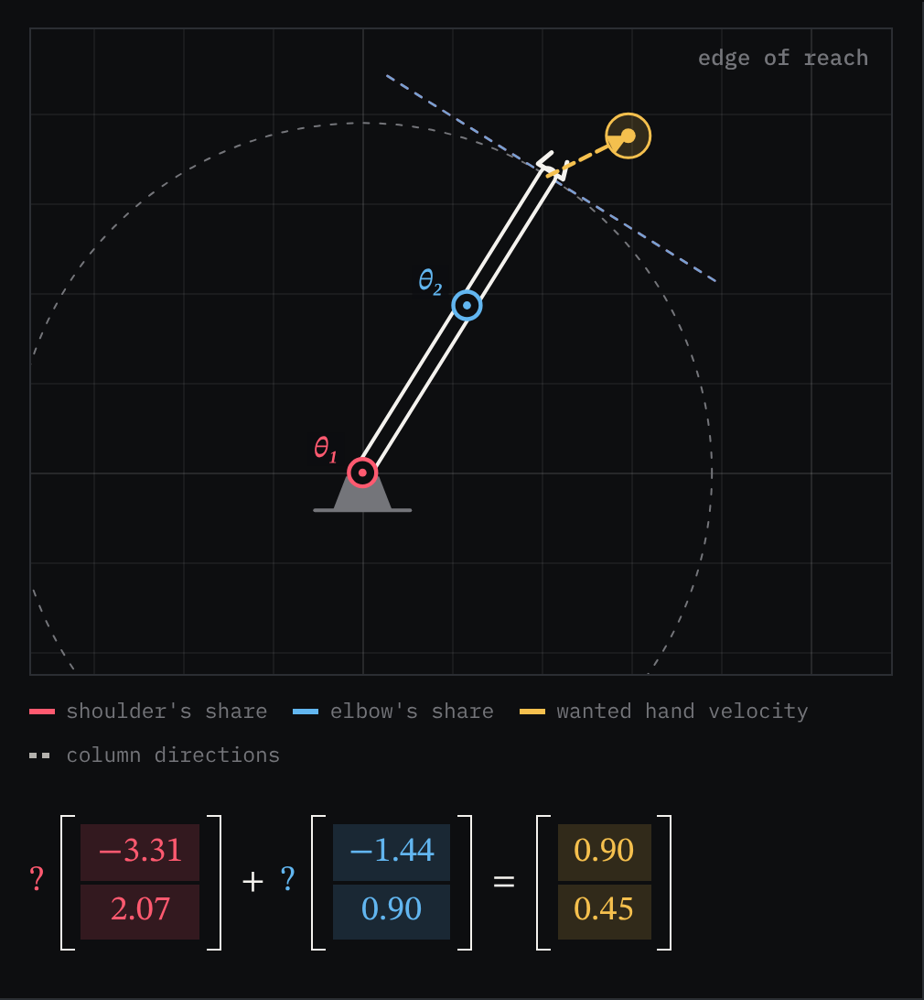

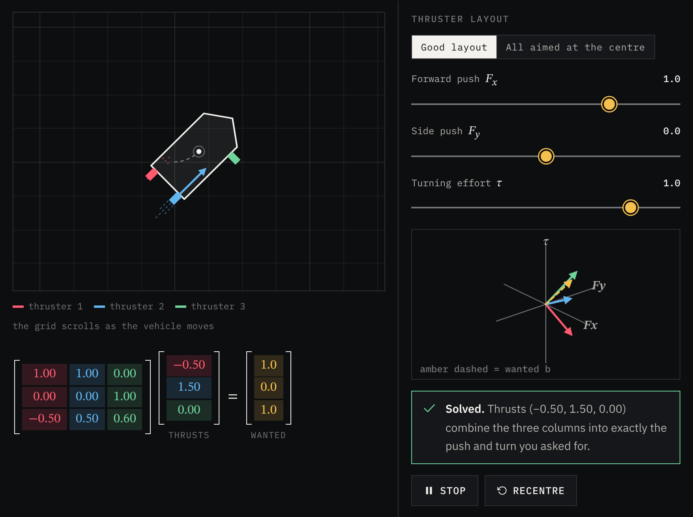

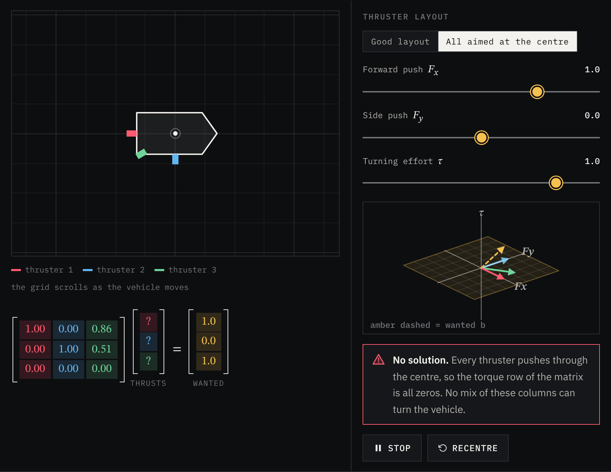

## Capstone: one robot, seven lectures

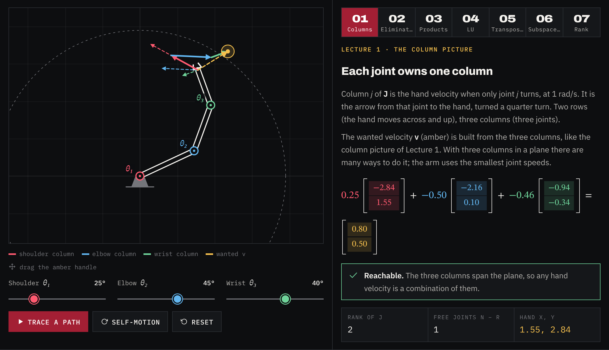

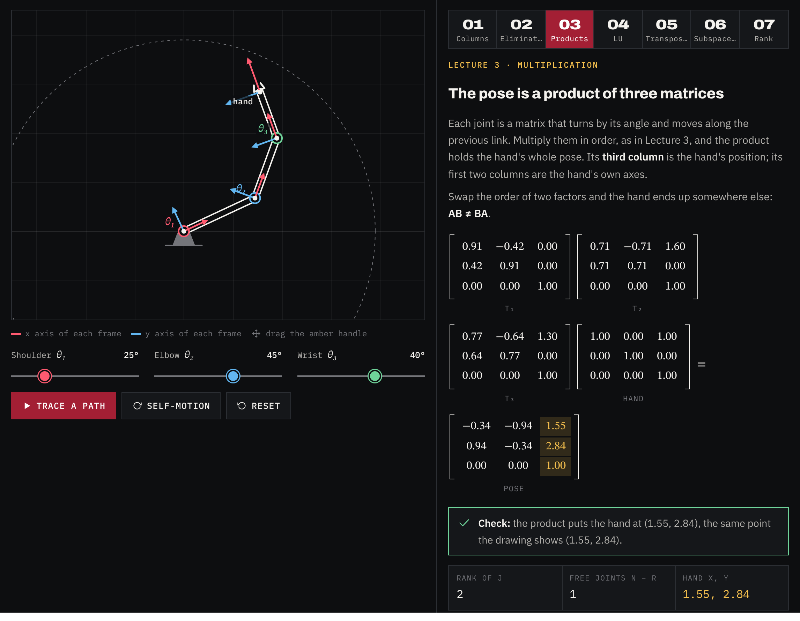

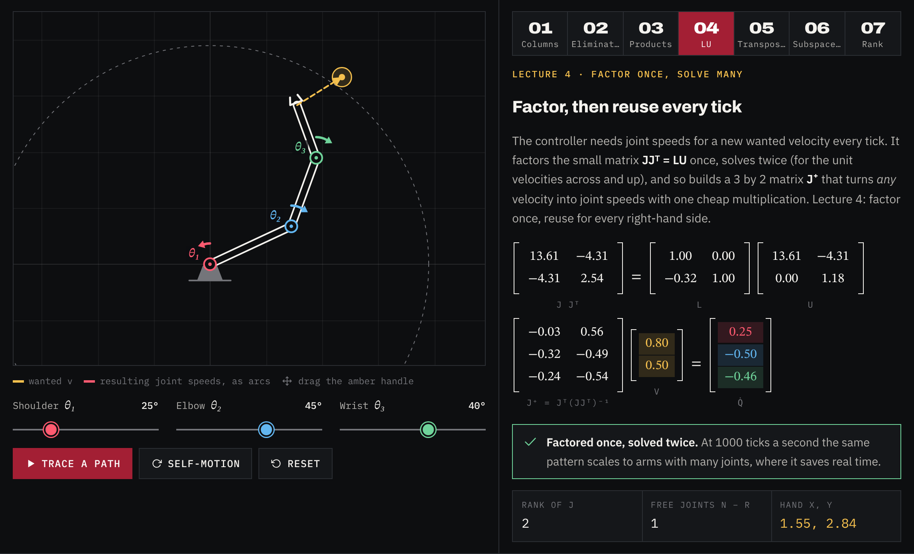

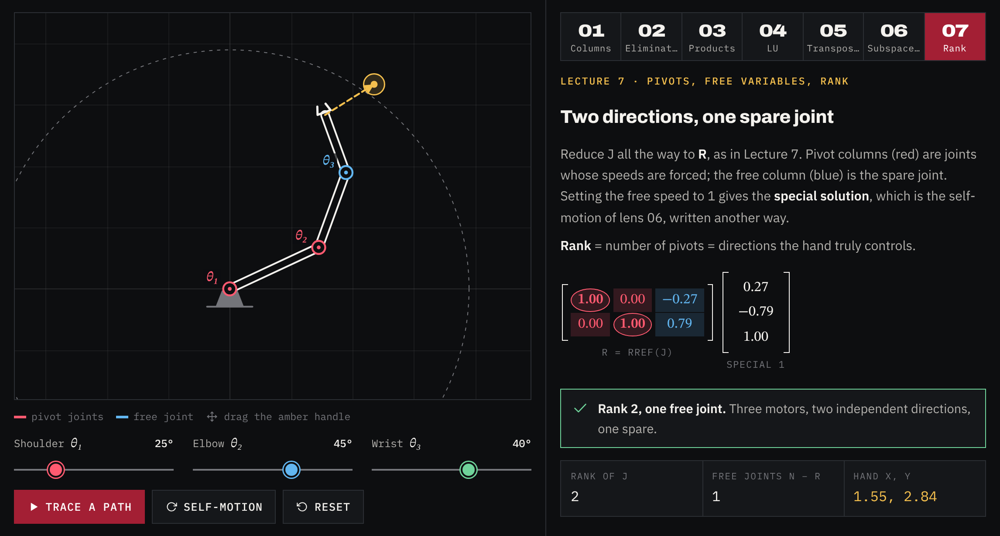

